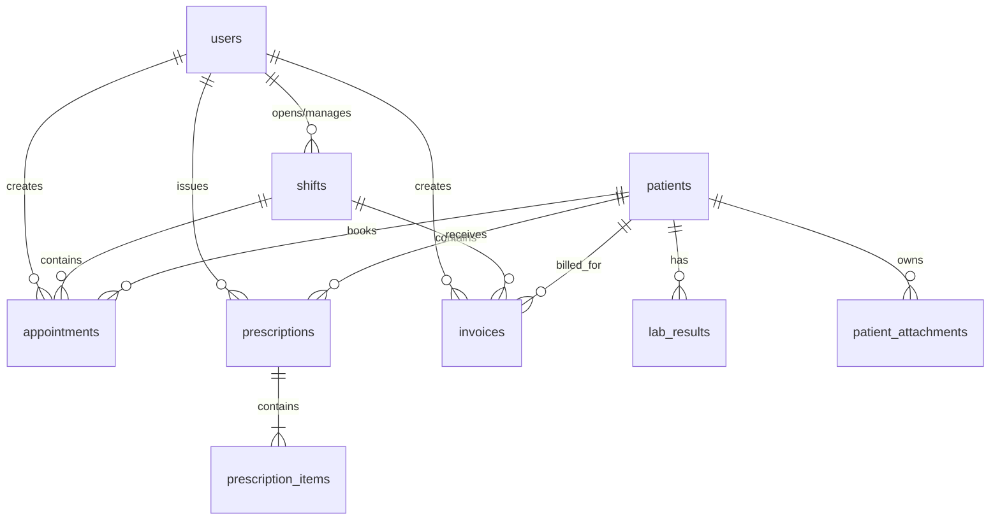
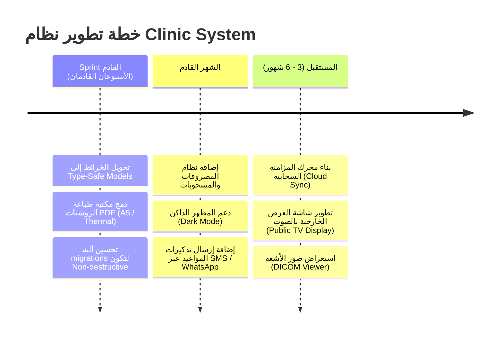

# 📊 التقرير والبرومبت التوثيقي الكامل لمشروع Clinic System (نظام إدارة العيادات الذكي)

---

## 1️⃣ نظرة عامة على المشروع (Project Overview)

### 📌 وصف المشروع
**Clinic System** هو نظام إدارة عيادات ومراكز طبية ذكي وشامل، صُمم باستخدام إطار عمل **Flutter (Material 3)** ولغة **Dart** ليعمل بكفاءة عالية على منصات متعددة (**Desktop**: Windows/macOS/Linux و **Mobile**: Android/iOS).
يعتمد التطبيق بشكل كامل على التخزين المحلي والتشغيل المستقل (**Offline-First System**) باستخدام قاعدة بيانات **SQLite (via `sqflite` & `sqflite_common_ffi`)**، مما يضمن سرعة فائقة واستقراراً كاملاً دون الحاجة لاتصال دائم بالإنترنت.

### 👥 المستخدمون المستهدفون
1. **الأطباء (Doctors):** معاينة قوائم الانتظار، كتابة التشخيص السريري والروشتة الإلكترونية، واستعراض الملف الطبي التراكمي للمريض (EMR).
2. **موظفو الاستقبال (Receptionists):** تسجيل المرضى، حجز وتحويل المواعيد، الإشراف على شاشة الانتظار، وإصدار الفواتير المالية.
3. **مديرو النظام والسوبر أدمن (Super Admins):** إدارة الورديات المالية الصندوقية، التحكم في حسابات الطاقم الطبي، وضبط صلاحيات الأقسام (RBAC).

### 💡 المشكلة التي يحلها التطبيق
- **فقدان وتشتت الملفات الطبية:** يوفر سجل رعاية مركزياً (EMR) يربط الفحوصات والروشتات والمرفقات السابقة بكل مريض.
- **التسرب المالي وغياب الرقابة على الصندوق:** يفرض نظام **الورديات المالية (Financial Shift Guard)** الذي يمنع إجراء أي حجز أو فاتورة أو روشتة دون فتح وردية مالية نشطة وتحديد النقدية الافتتاحية.
- **بطء وتنظيم طوابير الانتظار:** يوفر شاشة استقبال وتتبع لحظي لنقل الحالات بين "منتظر"، "في الكشف"، و "مكتمل".
- **عجز وسوء إدارة المخزون الطبي:** تتبع أرقام التشغيلات (Lot No) وتنبيهات نفاذ وصلاحية الكواشف والمستلزمات الطبية.

### ⚙️ المواصفات التقنية البيئية
- **Flutter SDK:** `^3.12.1` | **Dart SDK:** `^3.x`
- **النمط المرئي:** Material Design 3 مع دعم متكامل للواجهات الاستجابة (Responsive Layouts) والتجاه الأيمن للأيسر (RTL Arabic).

---

## 2️⃣ المعمارية التقنية (Technical Architecture)

يعتمد المشروع على هندسة برمجية منسقة تجمع بين مفاهيم **Clean Architecture** ونمط **MVVM (Model-View-ViewModel)** مدعوماً بـ **Cubit (Flutter BLoC)** لإدارة حالات التطبيق.

### 🏛️ طبقات المعمارية (Architectural Layers)

```
lib/
├── core/                  # الطبقة المركزية (الخدمات المشتركة، الأمن، الألوان، قاعدة البيانات)
│   ├── base/              # BaseViewModel المعتمد على ChangeNotifier
│   ├── common/            # إدارة الأخطاء (Failure & AppLogger)
│   ├── database/          # SQLite DatabaseHelper & Migrations
│   ├── di/                # GetIt Service Locator
│   ├── security/          # SessionManager & ShiftGuard
│   └── theme/             # AppTheme & AppColors (Material 3)
├── modules/               # الطبقة التجميعية بحسب الميزات (Feature Modules)
│   ├── auth/              # وحدة المصادقة وتخليص الجلسة
│   ├── shift/             # وحدة إدارة الورديات المالية
│   ├── splash/            # شاشة التمهيد وتفقد الجلسة المتبقية
│   ├── main_shell/        # الهيكل الرئيسي والقائمة الجانبية (Sidebar Grid)
│   ├── clinic/            # وحدة خدمات العيادة الرئيسية (9 شاشات)
│   └── shared/            # المكونات الهيكلية للـ Cubit (BaseCubit & BlockBuilderWidget)
└── main.dart              # نقطة الانطلاق وإعداد الـ Localizations
```

1. **Presentation Layer (طبقة العرض):**
   - **Screens / Views:** واجهات المستخدم المكتوبة بـ Flutter.
   - **ViewModels:** فئات تمتد من [BaseViewModel](file:///h:/softBridge%20company%20work/mobileApp/clinic_system/lib/core/base/base_view_model.dart) لتبسيط التحكم في متحكمات النصوص والقوائم المنسدلة بدون تفكيك منطق الأعمال.
   - **Cubits:** فئات تمتد من [BaseCubit](file:///h:/softBridge%20company%20work/mobileApp/clinic_system/lib/modules/shared/cubit/base_cubit.dart) للتفاعل مع مستودعات البيانات وبث حالات UI بـ **POST Pattern** مخصص يمنع إعادة بناء الأجزاء غير المتأثرة عبر `BlockBuilderWidget`.

2. **Data Layer (طبقة البيانات):**
   - **Repositories:** الفئات المسؤولة عن تنفيذ الاستعلامات وسحب البيانات من قواعد البيانات وتغليف النتائج بـ `Either<Failure, T>`.
   - **DatabaseHelper:** فئة أُنشئت بنمط Singleton لإدارة الاتصال بقواعد بيانات SQLite وتنفيذ الـ DDL والـ Seeding بـ FFI.

3. **DI & Security (الحاقن والأمان):**
   - **Service Locator:** في [service_locator.dart](file:///h:/softBridge%20company%20work/mobileApp/clinic_system/lib/core/di/service_locator.dart) يتم تسجيل الـ Repositories كـ `LazySingleton` والـ ViewModels كـ `Factory`.
   - [SessionManager](file:///h:/softBridge%20company%20work/mobileApp/clinic_system/lib/core/security/session_manager.dart): يقرأ ويحفظ بيانات المستخدم والوردية النشطة محلياً وقرصياً (`clinic_active_session.json`).
   - [ShiftGuard](file:///h:/softBridge%20company%20work/mobileApp/clinic_system/lib/core/security/shift_guard.dart): صمام أمان يمنع تنفيذ أي حجز أو فاتورة أو روشتة دون فتح وردية مالية.

---

## 3️⃣ شرح تفصيلي لجميع الشاشات واللوجيك الخاص بها (Screens & Detailed Logic)

### 1. شاشة تسجيل الدخول (`login_screen.dart` & `login_view_model.dart`)
- **الوظيفة:** التحقق من هوية المستخدم ودوره واستعادة الجلسة والعبور للنظام.
- **منطق العمل (Detailed Logic Flow):**
  1. يربط الـ UI الحقول بالمتحكمات `usernameController` و `passwordController` بـ `LoginViewModel`.
  2. عند الضغط على "تسجيل الدخول": يتم تفقد صحة المدخلات `_formKey.currentState!.validate()`.
  3. يتم استدعاء `_viewModel.submitLogin(...)` التي تستدعي `authCubit.login(username, password)`.
  4. ينفذ `AuthRepoImpl` استعلاماً بالجدول `users` بـ `where: username = ? AND password = ? AND is_active = 1`.
  5. عند نجاح الاستعلام: يُستدعى `SessionManager.instance.setUserSession` لتفكيك `permissions_json` وحفظ ملف الجلسة `clinic_active_session.json` على القرص الصلب.
  6. التوجيه: يتفقد النظام `SessionManager.instance.hasActiveShift`. إن كانت هناك وردية مفتوحة للمستخدم، ينتقل لـ `ClinicMainShell`؛ وإن لم توجد، ينقله لشاشة `ShiftScreen`.

---

### 2. شاشة التمهيد والتحقق من الجلسة (`splash_screen.dart` & `splash_view_model.dart`)
- **الوظيفة:** تهيئة قواعد البيانات وتفقد الجلسات السابقة أثناء التحميل.
- **منطق العمل (Detailed Logic Flow):**
  1. ينتظر النظام تأخيراً زمنياً (1000ms) لإظهار الـ Splash branding.
  2. يتم الاتصال بقاعدة البيانات SQLite وتهيئة `SessionManager.instance.initPersistentSession()`.
  3. يقرأ النظام ملف `clinic_active_session.json` من القرص. إن وجد، يستعيد بيانات المستخدم والوردية النشطة من جدول `shifts` حيث `is_closed == 0`.
  4. التوجيه الفرعي:
     - إذا لم يكن المستخدم مسجلاً دخول -> الانتقال لـ `LoginScreen`.
     - إذا كان مسجلاً دخول وبدون وردية -> الانتقال لـ `ShiftScreen`.
     - إذا كان مسجلاً دخول بوردية نشطة -> الانتقال مباشرة لـ `ClinicMainShell`.

---

### 3. شاشة الوردية المالية وتدفقات الصندوق (`shift_screen.dart` & `shift_view_model.dart`)
- **الوظيفة:** فتح وردية مالية جديدة بتسجيل عهدة الصندوق الافتتاحية، أو إغلاق الوردية الحالية وجرد الخزينة.
- **منطق العمل (Detailed Logic Flow):**
  1. عند الفتح: ينفذ `checkInitialShift()` للاستعلام عن وجود وردية مفتوحة للمستخدم من `shiftCubit.fetchActiveShift(userId)`.
  2. **إذا كانت الوردية مفتوحة:**
     - تُعرض بطاقة الوردية النشطة (رقم الوردية، وقت البدء، المبلغ الافتتاحي، الملاحظات).
     - زر "الدخول لملف العيادة" ينقل لـ `ClinicMainShell`.
     - زر "إغلاق الوردية المالية" يفتح نافذة جرد المبلغ الختامي `_showCloseShiftDialog`؛ وعند التأكيد ينفذ `shiftCubit.closeShift(shiftId, endingCash)` بتحديث جدول `shifts` بـ `end_time = now`, `ending_cash = endingCash`, `is_closed = 1` وتفريغ الجلسة من `activeShift`.
  3. **إذا لم تكن هناك وردية:**
     - يُعرض نموذج تحديد وقت وتاريخ البدء ومبلغ العهدة النقدية الافتتاحية والملاحظات.
     - الضغط على "بدء الوردية" ينفذ `shiftCubit.startShift(...)` بتسجيل سطر جديد بجدول `shifts` وتحديث `SessionManager.activeShift` وتمكين الوصول للنظام.

---

### 4. الهيكل الرئيسي والقائمة الجانبية (`clinic_main_shell.dart` & `main_shell_view_model.dart`)
- **الوظيفة:** احتواء الشاشات التسع وإدارة التبويب والتوجيه المبني على الصلاحيات (RBAC).
- **منطق العمل (Detailed Logic Flow):**
  1. يقرأ الـ ViewModel صلاحيات المستخدم `userPermissions` من `SessionManager`.
  2. يُصفي قائمة الأقسام `allMenuItems` بحسب الصلاحيات المتاحة للمستخدم `hasPermission(key)`.
  3. **على الأجهزة المكتبية (Desktop >= 1024px):** يثبت شريطاً جانبياً بعرض 260px على اليمين ويستعرض الشاشة النشطة في المساحة اليسرى المتبقية عبر `KeyedSubtree` و `_getScreenWidget(key)`.
  4. **على الهواتف (< 1024px):** يعرض AppTopBar بـ Drawer جانبي للملاحة.
  5. عند الضغط على زر تسجيل الخروج: يُطلب تأكيد المستخدم، وعند التأكيد يتم مسح ملف الجلسة بـ `SessionManager.clearSession()` والتوجيه لـ `LoginScreen`.

---

### 5. شاشة لوحة التحكم الإحصائية (`dashboard_screen.dart`)
- **الوظيفة:** استعراض المؤشرات اليومية لأداء العيادة والإيرادات والمواعيد.
- **منطق العمل (Detailed Logic Flow):**
  1. عند الفتح: يستدعي `clinicCubit.fetchDashboardStats()`.
  2. ينفذ `ClinicRepoImpl.getDashboardStats()` أربع استعلامات تجميعية SQL:
     - عدد مواعيد اليوم (`appointment_date LIKE 'yyyy-MM-dd%'`).
     - عدد الحالات بقائمة الانتظار (`status = 'منتظر'`).
     - إجمالي ملفات المرضى المسجلة.
     - إجمالي الإيرادات المحصلة اليوم (`SUM(paid_amount)` من جدول `invoices`).
  3. تبث الكيوبيت الحالة `ClinicApiType.getDashboard` وتعرض 4 بطاقات KPI استجابية.

---

### 6. شاشة المواعيد والحجوزات (`appointments_screen.dart`)
- **الوظيفة:** حجز مواعيد جديدة، تحديد الأولوية والتوقيت، ومتابعة جدول الزيارات.
- **منطق العمل (Detailed Logic Flow):**
  1. يستدعي النظام المواعيد والمرضى والأطباء عند initState.
  2. عند الضغط على "تسجيل موعد جديد": يستدعي `ShiftGuard.checkShiftOrWarn(context)`:
     - إذا لم تكن توجد وردية نشطة: يُعرض تنبيه يحظر الحجز ويطلب فتح وردية جديدة فوراً.
     - إذا كانت هناك وردية نشطة: تُفتح نافذة الحجز `_showBookingDialog`.
  3. في نافذة الحجز: يختار الموظف نوع الموعد، المريض، تاريخ ووقت الحجز، الطبيب، الأولوية (عادي/مستعجل/طارئ)، والشكوى.
  4. عند التأكيد: يستدعي `clinicCubit.addAppointment(...)` لتسجيل سطر في جدول `appointments` بحالة أولية "منتظر" ويرتبط بـ `shift_id` الوردية الحالية.
  5. تُحدث الشاشة وقائمة غرفة الانتظار فوراً.

---

### 7. شاشة غرفة الانتظار والاستقبال (`waiting_room_screen.dart`)
- **الوظيفة:** تنظيم دور المرضى بأسبقية الحضور وإدخالهم لغرفة الكشف.
- **منطق العمل (Detailed Logic Flow):**
  1. ينفذ `clinicCubit.fetchWaitingQueue()`.
  2. يستعلم `ClinicRepoImpl.getWaitingRoomQueue()` من جدول `appointments` المدمج مع `patients` للحالات ذات `status IN ('منتظر', 'في الكشف')` مرتبة تصاعدياً بـ `id ASC`.
  3. الإجراءات:
     - زر "إدخال للكشف" (للحالات المنتظرة): يستدعي `clinicCubit.updateAppointmentStatus(id, 'في الكشف')` لتحديث حالة الموعد بجدول SQLite ومزامنة القائمة.
     - زر "إنهاء الكشف" (للحالات داخل الكشف): يستدعي `clinicCubit.updateAppointmentStatus(id, 'مكتمل')` لإخراج الحالة من صالة الانتظار.

---

### 8. شاشة الملف الطبي الشامل للمرضى (`emr_screen.dart`)
- **الوظيفة:** السجل الطبي السريري للمريض، التحاليل التراكمية، والروشتات والمرفقات.
- **منطق العمل (Detailed Logic Flow):**
  1. تقسيم الواجهة: 35% قائمة المرضى على اليمين مع شريط بحث حي، 65% الملف السريري للمريض المختار على اليسار.
  2. إضافة مريض جديد: نافذة بـ 4 أقسام (البيانات الشخصية والسن المحسوب، البيانات السريرية وفصيلة الدم والحالة الفسيولوجية للأنثى، هاتف الطوارئ والتعاقد، الأمراض المزمنة والحساسية). يُسجل المريض بجدول `patients`.
  3. اختيار مريض: يستدعي `clinicCubit.fetchPatientRecord(patientId)` الذي ينفذ 5 استعلامات متزامنة (`patients`, `appointments`, `prescriptions`, `lab_results`, `patient_attachments`).
  4. استعراض الملف في 3 تبويبات:
     - **التحاليل التراكمية (Lab Trends):** استعراض التحاليل بفرز مسبق ووسوم حالة (طبيعي/مرتفع/منخفض). زر إضافة فحص ينفذ الإدراج بـ `lab_results`.
     - **الروشتات والمرفقات:** استعراض الروشتات الصادرة والمستندات الطبية المرفقة.
     - **التاريخ الدوائي والملاحظات:** عرض التداخلات والملاحظات السريرية.

---

### 9. شاشة الكشف والروشتة الإلكترونية (`consultation_screen.dart`)
- **الوظيفة:** منطقة عمل الطبيب لكتابة التشخيص والتعليمات وإصدار روشتة الأدوية.
- **منطق العمل (Detailed Logic Flow):**
  1. يختار الطبيب المريض، يكتب التشخيص والتعليمات، ويضيف عناصر الأدوية (الاسم، الجرعة، التكرار، المدة) في قائمة `prescriptionItems` بـ ViewModel.
  2. عند الضغط على "حفظ وطباعة الروشتة":
     - يفحص النظام صمام الوردية `ShiftGuard`.
     - يستدعي `clinicCubit.addPrescription(...)`.
     - ينفذ `ClinicRepoImpl.addPrescription` **معاملة دمج بقاعدة البيانات (Database Transaction)**: يُدرج الروشتة أولاً في `prescriptions` ثم يدور على الأدوية ويدرج كل دواء بـ `prescription_items` بذات `prescription_id`.
     - تُفرغ الواجهة ويتم تحديث سجل المريض فوراً.

---

### 10. شاشة الحسابات والفواتير (`billing_screen.dart`)
- **الوظيفة:** إصدار الفواتير وتحصيل المبالغ ومطابقتها مع عهدة الوردية.
- **منطق العمل (Detailed Logic Flow):**
  1. يستعرض شريط العهدة النقدية الافتتاحية للوردية الحالية `Starting Cash: X EGP`.
  2. استعلام الفواتير: يجلب البيانات من `invoices` مدمجة مع `patients` و `users`.
  3. إصدار فاتورة جديدة: يتفقد `ShiftGuard` ثم يفتح نافذة تحديد المريض، المبلغ الإجمالي، الخصم، المدفوع، وطريقة الدفع.
  4. يسجل السجل بجدول `invoices` بربط مباشر بـ `shift_id` لتوفير إمكانية مطابقة الخزينة عند إغلاق الوردية.

---

### 11. شاشة مخزن المستلزمات والكواشف (`inventory_screen.dart`)
- **الوظيفة:** متابعة رصيد المستلزمات الطبية وأرقام التشغيلات (Lot No) والتنبيهات.
- **منطق العمل (Detailed Logic Flow):**
  1. يُحسب مؤشر KPI (قيمة المخزون، النواقص، وشك الانتهاء، المنفذة) عبر استعلام جدول `inventory`.
  2. فلترة وبحث: بالاسم، الباركود، رقم التشغيلة، أو تفعيل مفتاح "النواقص فقط ⚠️".
  3. الإجراءات المباشرة:
     - زر التوريد (+): ينفذ `updateInventoryItem(id, qty + 10)` بتحديث الكمية بجدول `inventory`.
     - زر الصرف (-): ينفذ `updateInventoryItem(id, qty - 1)`.
     - إضافة صنف جديد: نافذة بـ 3 أقسام (اسم الصنف والباركود، رقم التشغيلة Lot No والتاريخ وشروط التخزين، والكمية وحد الأمان والمورد) تُسجل بالجدول `inventory`.

---

### 12. شاشة التقارير والإحصائيات (`reports_screen.dart`)
- **الوظيفة:** استعراض تقارير الإيرادات والمواعيد التجميعية وتصدير البيانات.
- **منطق العمل (Detailed Logic Flow):**
  1. ينفذ `clinicCubit.fetchReports()`.
  2. يستعلم `ClinicRepoImpl.getReports` لحساب الإيرادات الكلية من `invoices` والمواعيد والمرضى ونواقص المستلزمات من `inventory`.
  3. يعرض البطاقات الإحصائية ويسمح بالتصدير.

---

### 13. شاشة الإعدادات وإدارة المستخدمين (`settings_screen.dart`)
- **الوظيفة:** إدارة حسابات الطاقم الطبي وضبط صلاحيات الأقسام (RBAC).
- **منطق العمل (Detailed Logic Flow):**
  1. يستعلم عن المستخدمين من جدول `users`.
  2. عند إنشاء/تعديل مستخدم: نافذة تسمح بإدخال الاسم، اسم الدخول، كلمة المرور، الفرع، الدور، وتحديد 9 مربعات اختيار للصلاحيات (`dashboard`, `appointments`, `waiting_room`, `emr`, `consultation`, `billing`, `inventory`, `reports`, `settings`).
  3. يُحفظ السجل بجدول `users` مع تحويل الصلاحيات المحددة لـ String بـ `jsonEncode(permissions)`.
  4. إذا تم تعديل حساب المستخدم اللوجن حالياً: يُحدث `SessionManager.instance.setUserSession` الصلاحيات فوراً دون الحاجة لإعادة الدخول.

---

## 4️⃣ قاعدة البيانات ومخطط العلاقات (Database Schema & ERD)

تحتوي قاعدة البيانات في [database_helper.dart](file:///h:/softBridge%20company%20work/mobileApp/clinic_system/lib/core/database/database_helper.dart) على **10 جداول**:
1. `users` | 2. `shifts` | 3. `patients` | 4. `appointments` | 5. `prescriptions` | 6. `prescription_items` | 7. `invoices` | 8. `inventory` | 9. `lab_results` | 10. `patient_attachments`.



---

## 5️⃣ قرارات الإضافة والتعديل والحذف (Add, Modify, Delete Decisions)

### ➕ ما يجب إضافته (Features to ADD):
1. **طباعة الفواتير والروشتات (PDF & Receipt Printing):** مكتبات `pdf` و `printing` لطباعة روشتات A5 وفواتير كاشير 80mm.
2. **إدارة المصروفات والمسحوبات:** تتبع مصروفات العيادة التشغيلية لمعرفة صافي الربح الحقيقي.
3. **المزامنة السحابية (Cloud Sync Engine):** مزامنة خلفية مع Supabase/Firebase لربط أكثر من فرع.
4. **تنبيهات WhatsApp/SMS:** تذكير تلقائي للمريض بالموعد قبل كشفه.
5. **شاشة النداء الصوتي بصالة الانتظار (Public TV Screen):** نداء رقم المريض واسم الطبيب صوتياً على شاشة التلفزيون.
6. **المظهر الداكن (Dark Mode):** وضع ليلي مريح لعين الأطباء أثناء النبطشيات.

### 🛠️ ما يجب تعديله (Things to MODIFY):
1. **Type-Safe Models:** تحويل معاملات `Map<String, dynamic>` إلى Dart Objects (`PatientModel`, `AppointmentModel`, etc.).
2. **Non-destructive Migrations:** استخدام `ALTER TABLE` بدلاً من `DROP TABLE` عند ترقية قاعدة البيانات للحفاظ على البيانات.
3. **Enums بدلاً من النصوص الحرة:** تحويل أدوار المستخدمين وحالات المواعيد إلى Dart Enums.
4. **تنسيق التواريخ:** توحيد دالة تنسيق التاريخ بـ `DateTimeUtils`.

### ❌ ما يجب حذفه واستبعاده (Things to DELETE):
1. **المسارات الوهمية للمرفقات:** استبدال `sample_path.png` بـ `file_picker` لتخزين ملفات الحقيقية.
2. **فك تشفير JSON من الـ UI:** نقل كود فك `permissions_json` في شاشة الإعدادات إلى داخل الـ Repo/Model.

---

## 6️⃣ خطة التطوير (Product Roadmap)



---
*تم إعداد وتنسيق هذا التقرير الشامل بناءً على الفحص المباشر والدقيق لجميع ملفات وشاشات ولوجيك كود مشروع Clinic System.*
