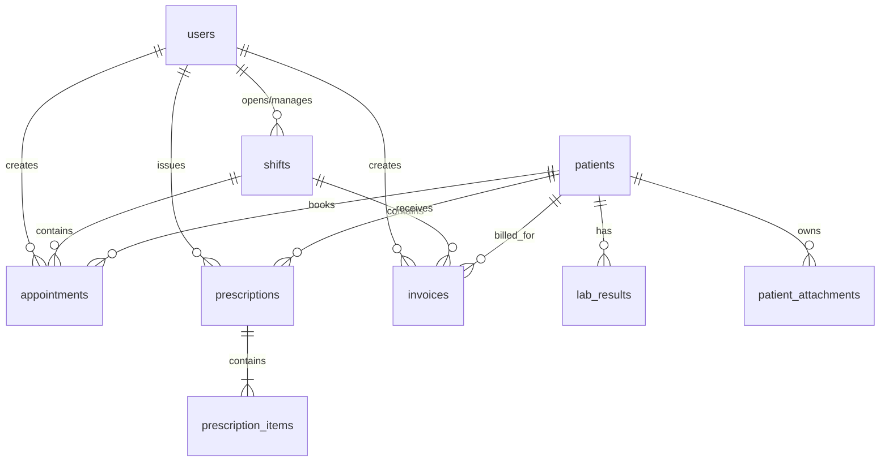
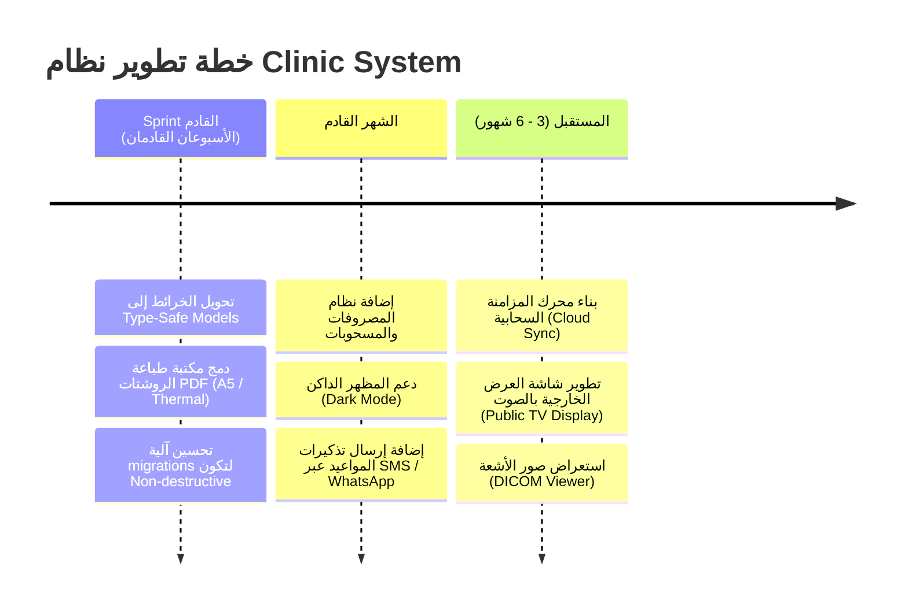

# 📊 تقرير توثيق ودليل مشروع Clinic System (نظام إدارة العيادات الذكي)

---

## 1️⃣ نظرة عامة على المشروع (Project Overview)

### 📌 وصف المشروع
**Clinic System** هو نظام إدارة عيادات ومراكز طبية ذكي وشامل، صُمم باستخدام إطار عمل **Flutter (Material 3)** ولغة **Dart** ليعمل بكفاءة عالية على منصات متعددة (**Desktop**: Windows/macOS/Linux و **Mobile**: Android/iOS).
يعتمد التطبيق بشكل كامل على التخزين المحلي والتشغيل المستقل (**Offline-First System**) باستخدام قاعدة بيانات **SQLite (via `sqflite` & `sqflite_common_ffi`)**، مما يضمن سرعة فائقة واستقراراً كاملاً دون الحاجة لاتصال دائم بالإنترنت.

### 👥 المستخدمون المستهدفون
1. **الأطباء (Doctors):** معاينة قوائم الانتظار، كتابة التشخيص السريري والروشتة الإلكترونية، واستعراض الملف الطبي التراكمي للمريض (EMR).
2. **موظفو الاستقبال (Receptionists):** تسجيل المرضى، حجز وتحويل المواعيد، الإشراف على شاشة الانتظار، وإصدار الفواتير المالية.
3. **مديرو النظام والسوبر أدمن (Super Admins):** إدارة الورديات المالية الصندوقية، التحكم في حسابات الطاقم الطبي، وضبط صلاحيات الأقسام (RBAC).

### 💡 المشكلة التي يحلها التطبيق
- **فقدان وتشتت الملفات الطبية:** يوفر سجل رعاية مركزياً (EMR) يربط الفحوصات والروشتات والمرفقات السابقة بكل مريض.
- **التسرب المالي وغياب الرقابة على الصندوق:** يفرض نظام **الورديات المالية (Financial Shift Guard)** الذي يمنع إجراء أي حجز أو فاتورة أو روشتة دون فتح وردية مالية نشطة وتحديد النقدية الافتتاحية.
- **بطء وتنظيم طوابير الانتظار:** يوفر شاشة استقبال وتتبع لحظي لنقل الحالات بين "منتظر"، "في الكشف"، و "مكتمل".
- **عجز وسوء إدارة المخزون الطبي:** تتبع أرقام التشغيلات (Lot No) وتنبيهات نفاذ وصلاحية الكواشف والمستلزمات الطبية.

### ⚙️ المواصفات التقنية البيئية
- **Flutter SDK:** `^3.12.1`
- **Dart SDK:** `^3.x`
- **النمط المرئي:** Material Design 3 مع دعم متكامل للواجهات الاستجابة (Responsive Layouts) والتجاه الأيمن للأيسر (RTL Arabic).

---

## 2️⃣ المعمارية التقنية (Technical Architecture)

يعتمد المشروع على هندسة برمجية منسقة تجمع بين مفاهيم **Clean Architecture** ونمط **MVVM (Model-View-ViewModel)** مدعوماً بـ **Cubit (Flutter BLoC)** لإدارة حالات التطبيق.

### 🏛️ طبقات المعمارية (Architectural Layers)

```
lib/
├── core/                  # الطبقة المركزية (الخدمات المشتركة، الأمن، الألوان، قاعدة البيانات)
│   ├── base/              # BaseViewModel المعتمد على ChangeNotifier
│   ├── common/            # إدارة الأخطاء (Failure & AppLogger)
│   ├── database/          # SQLite DatabaseHelper & Migrations
│   ├── di/                # GetIt Service Locator
│   ├── security/          # SessionManager & ShiftGuard
│   └── theme/             # AppTheme & AppColors (Material 3)
├── modules/               # الطبقة التجميعية بحسب الميزات (Feature Modules)
│   ├── auth/              # وحدة المصادقة وتخليص الجلسة
│   ├── shift/             # وحدة إدارة الورديات المالية
│   ├── splash/            # شاشة التمهيد وتفقد الجلسة المتبقية
│   ├── main_shell/        # الهيكل الرئيسي والقائمة الجانبية (Sidebar Grid)
│   ├── clinic/            # وحدة خدمات العيادة الرئيسية (9 شاشات)
│   └── shared/            # المكونات الهيكلية للـ Cubit (BaseCubit & BlockBuilderWidget)
└── main.dart              # نقطة الانطلاق وإعداد الـ Localizations
```

1. **Presentation Layer (طبقة العرض):**
   - **Screens / Views:** واجهات المستخدم المكتوبة بـ Flutter.
   - **ViewModels:** فئات تمتد من `BaseViewModel` لتبسيط التحكم في متحكمات النصوص (`TextEditingController`) والقوائم المنسدلة بدون تفكيك منطق الأعمال.
   - **Cubits:** فئات تمتد من `BaseCubit<Enum>` للتفاعل مع مستودعات البيانات وبث حالات UI دون تعقيد.

2. **Domain / Core Layer (طبقة النواة وقواعد العمل):**
   - تحوي نماذج الأخطاء `Failure` ومعالجات الأمان `ShiftGuard` وحارس الجلسات `SessionManager`.

3. **Data Layer (طبقة البيانات):**
   - **Repositories:** الفئات المسؤولة عن تنفيذ الاستعلامات وسحب البيانات من قواعد البيانات وتغليف النتائج بـ `Either<Failure, T>`.
   - **DatabaseHelper:** فئة أُنشئت بنمط Singleton لإدارة الاتصال بقواعد بيانات SQLite وتنفيذ الـ DDL والـ Seeding.

### 🧩 أسباب اختيار المكتبات الرئيسية
- **`flutter_bloc` & `Cubit`:** لإدارة الحالة وتطبيق نمط **POST Pattern** بإنشاء حالات مميزة عبر `BaseCubit<Enum>` لمنع إعادة بناء الشاشة بالكامل أثناء استدعاء الأوامر.
- **`get_it`:** كمحدد خدمات (**Service Locator**) لإدارة التبعيات وتنفيذ حاقن التبعيات (**Dependency Injection**).
- **`dartz`:** لتطبيق نمط البرمجة الوظيفية عبر البرمجة الموجهة للأخطاء متضمناً `Either<Failure, T>` لضمان معالجة الأخطاء دون انهيار التطبيق.
- **`sqflite` & `sqflite_common_ffi`:** لتمكين قاعدة بيانات SQLite محلية فائقة السرعة تعمل على الهواتف والأجهزة المكتبية (Desktop FFI) بذات الكود.

### 💉 ترتيب حاقن التبعيات (Dependency Injection Setup)

في الملف [service_locator.dart](file:///h:/softBridge%20company%20work/mobileApp/clinic_system/lib/core/di/service_locator.dart)، يتم تسجيل الخدمات كالتالي:
- **Repositories (LazySingleton):** `AuthRepo`, `ShiftRepo`, `ClinicRepo`.
- **Cubits (Factory & Singleton):** `AuthCubit` (Factory), `ShiftCubit` (Factory), `ClinicCubit` (LazySingleton لحفظ حالة العيادة عبر التبويبات).
- **ViewModels (Factory):** `SplashViewModel`, `LoginViewModel`, `ShiftViewModel`, `MainShellViewModel`, `ClinicViewModel`.

### 🛡️ الأمن والورديات والصلاحيات (Security & Guards)
1. **SessionManager:** يُدير بيانات المستخدم الحالي وصلاحياته، ويقوم بحفظ الجلسة تلقائياً في ملف `clinic_active_session.json` للتعافي عند إعادة التشغيل.
2. **ShiftGuard:** صمام أمان يمنع تنفيذ أية عمليات مالية أو طبية (حجز، روشتة، فاتورة) ما لم توجد وردية مفتوحة (`is_closed == 0`) للمستخدم، ويعرض نافذة تنبيه للمستخدم للتوجيه لشاشة الوردية.
3. **RBAC (Role-Based Access Control):** تصفية عناصر القائمة الجانبية والأقسام بحسب قائمة `permissions_json` الخاصة بالحساب المسجل.

---

## 3️⃣ هيكل المجلدات والشجرة الكاملة (Directory Tree)

```
lib/
├── main.dart                                  # التهيئة، إعداد الـ DI والتوطين (RTL Arabic)
├── core/
│   ├── base/
│   │   └── base_view_model.dart               # القاعدة الأساسية للـ ViewModels (ChangeNotifier)
│   ├── common/
│   │   └── error_handler/
│   │       ├── app_logger.dart                # مسجل الملاحظات والأخطاء بالنظام
│   │       └── failure.dart                   # نموذج تعريف خطأ العملية Failure
│   ├── database/
│   │   └── database_helper.dart               # إنشاء الجداول، السقاطات (10 جداول)، والبذر الأول
│   ├── di/
│   │   └── service_locator.dart               # تسجيل التبعيات عبر GetIt
│   ├── security/
│   │   ├── session_manager.dart               # إدارة الجلسات وحفظها قرصياً
│   │   └── shift_guard.dart                   # الفاحص الأمني لوجود وردية نشطة
│   └── theme/
│       ├── app_colors.dart                    # الألوان الطبية المعيارية Medical Teal & Dark Sidebar
│       └── app_theme.dart                     # ثيم Material 3 للمدخلات والأزرار والبطاقات
└── modules/
    ├── auth/
    │   ├── data/
    │   │   ├── cubit/auth_cubit.dart          # كيو بت تسجيل الدخول
    │   │   └── repo/auth_repo.dart            # المستودع والاستعلام من جدول users
    │   └── view/
    │       ├── login_screen.dart              # شاشة تسجيل الدخول بالتصميم المزدوج (Responsive)
    │       └── login_view_model.dart          # إدارة متحكمات النصوص لنموذج الدخول
    ├── shift/
    │   ├── data/
    │   │   ├── cubit/shift_cubit.dart         # كيو بت الوردية وتدفقات الصندوق
    │   │   └── repo/shift_repo.dart           # عمليات البدء، الإغلاق، والسجل للورديات
    │   └── view/
    │       ├── shift_screen.dart              # شاشة فتح وإغلاق الوردية المالية
    │       └── shift_view_model.dart          # إدارة التوقيت، النقدية الافتتاحية والختامية
    ├── splash/
    │   └── view/
    │       ├── splash_screen.dart             # شاشة البداية والتحميل
    │       └── splash_view_model.dart         # تفقد استعادة الجلسة والتوجه للشاشة المناسبة
    ├── main_shell/
    │   └── view/
    │       ├── clinic_main_shell.dart         # الهيكل الرئيسي المتضمن القائمة الجانبية (Sidebar)
    │       └── main_shell_view_model.dart     # إدارة التبويب النشط وفحص الصلاحيات المتاحة
    ├── clinic/
    │   ├── data/
    │   │   ├── cubit/clinic_cubit.dart        # الكيو بت الرئيسي للعيادة (20 نوع حدث)
    │   │   └── repo/clinic_repo.dart          # مستودع البيانات الرئيسي لعمليات SQLite
    │   └── view/
    │       ├── clinic_view_model.dart         # ViewModel التجميعي لنموذج العيادة
    │       └── screens/
    │           ├── dashboard_screen.dart      # شاشة الإحصائيات اليومية
    │           ├── appointments_screen.dart   # شاشة جدول المواعيد والحجز
    │           ├── waiting_room_screen.dart   # شاشة الاستقبال وغرفة الانتظار
    │           ├── emr_screen.dart            # شاشة الملف الطبي الإلكتروني للمرضى
    │           ├── consultation_screen.dart   # شاشة الكشف والروشتة الإلكترونية
    │           ├── billing_screen.dart        # شاشة الفواتير والتحصيل
    │           ├── inventory_screen.dart      # شاشة مخزن الكواشف والمستلزمات
    │           ├── reports_screen.dart        # شاشة التقارير المالية والإحصائية
    │           └── settings_screen.dart       # شاشة الإعدادات وإدارة صلاحيات الطاقم
    └── shared/
        └── cubit/
            ├── base_cubit.dart                # البنية الهيكلية لـ BaseCubit و fastFire
            └── block_builder_widget.dart      # ودجت البناء المستهدف بناءً على حالة Enum
```

---

## 4️⃣ شرح تفصيلي لجميع شاشات النظام واللوجيك الخاص بها (Screens & Detailed Business Logic)

### 1. شاشة تسجيل الدخول (`login_screen.dart` & `login_view_model.dart`)
- **الوظيفة الأساسية:** التحقق من هوية المستخدم ودوره واستعادة الجلسة والعبور للنظام.
- **البيانات المعروضة:** حقول اسم المستخدم وكلمة المرور، لافتة العرض الترويجي للشاشات الكبيرة.
- **منطق العمل (Detailed Logic Flow):**
  1. يربط الـ UI الحقول بالمتحكمات `usernameController` و `passwordController` بـ `LoginViewModel`.
  2. عند الضغط على "تسجيل الدخول": يتم تفقد صحة المدخلات `_formKey.currentState!.validate()`.
  3. يتم استدعاء `_viewModel.submitLogin(...)` التي تستدعي `authCubit.login(username, password)`.
  4. ينفذ `AuthRepoImpl` استعلاماً بالجدول `users` بـ `where: username = ? AND password = ? AND is_active = 1`.
  5. عند نجاح الاستعلام: يُستدعى `SessionManager.instance.setUserSession` لتفكيك `permissions_json` وحفظ ملف الجلسة `clinic_active_session.json` على القرص الصلب.
  6. التوجيه: يتفقد النظام `SessionManager.instance.hasActiveShift`. إن كانت هناك وردية مفتوحة للمستخدم، ينتقل لـ `ClinicMainShell`؛ وإن لم توجد، ينقله لشاشة `ShiftScreen`.

---

### 2. شاشة التمهيد والتحقق من الجلسة (`splash_screen.dart` & `splash_view_model.dart`)
- **الوظيفة الأساسية:** تهيئة قواعد البيانات وتفقد الجلسات السابقة أثناء التحميل.
- **منطق العمل (Detailed Logic Flow):**
  1. ينتظر النظام تأخيراً زمنياً (1000ms) لإظهار الـ Splash branding.
  2. يتم الاتصال بقاعدة البيانات SQLite وتهيئة `SessionManager.instance.initPersistentSession()`.
  3. يقرأ النظام ملف `clinic_active_session.json` من القرص. إن وجد، يستعيد بيانات المستخدم والوردية النشطة من جدول `shifts` حيث `is_closed == 0`.
  4. التوجيه الفرعي:
     - إذا لم يكن المستخدم مسجلاً دخول -> الانتقال لـ `LoginScreen`.
     - إذا كان مسجلاً دخول وبدون وردية -> الانتقال لـ `ShiftScreen`.
     - إذا كان مسجلاً دخول بوردية نشطة -> الانتقال مباشرة لـ `ClinicMainShell`.

---

### 3. شاشة الوردية المالية وتدفقات الصندوق (`shift_screen.dart` & `shift_view_model.dart`)
- **الوظيفة الأساسية:** فتح وردية مالية جديدة بتسجيل عهدة الصندوق الافتتاحية، أو إغلاق الوردية الحالية وجرد الخزينة.
- **منطق العمل (Detailed Logic Flow):**
  1. عند الفتح: ينفذ `checkInitialShift()` للاستعلام عن وجود وردية مفتوحة للمستخدم من `shiftCubit.fetchActiveShift(userId)`.
  2. **إذا كانت الوردية مفتوحة:**
     - تُعرض بطاقة الوردية النشطة (رقم الوردية، وقت البدء، المبلغ الافتتاحي، الملاحظات).
     - زر "الدخول لملف العيادة" ينقل لـ `ClinicMainShell`.
     - زر "إغلاق الوردية المالية" يفتح نافذة جرد المبلغ الختامي `_showCloseShiftDialog`؛ وعند التأكيد ينفذ `shiftCubit.closeShift(shiftId, endingCash)` بتحديث جدول `shifts` بـ `end_time = now`, `ending_cash = endingCash`, `is_closed = 1` وتفريغ الجلسة من `activeShift`.
  3. **إذا لم تكن هناك وردية:**
     - يُعرض نموذج تحديد وقت وتاريخ البدء ومبلغ العهدة النقدية الافتتاحية والملاحظات.
     - الضغط على "بدء الوردية" ينفذ `shiftCubit.startShift(...)` بتسجيل سطر جديد بجدول `shifts` وتحديث `SessionManager.activeShift` وتمكين الوصول للنظام.

---

### 4. الهيكل الرئيسي والقائمة الجانبية (`clinic_main_shell.dart` & `main_shell_view_model.dart`)
- **الوظيفة الأساسية:** احتواء الشاشات التسع وإدارة التبويب والتوجيه المبني على الصلاحيات (RBAC).
- **منطق العمل (Detailed Logic Flow):**
  1. يقرأ الـ ViewModel صلاحيات المستخدم `userPermissions` من `SessionManager`.
  2. يُصفي قائمة الأقسام `allMenuItems` بحسب الصلاحيات المتاحة للمستخدم `hasPermission(key)`.
  3. **على الأجهزة المكتبية (Desktop >= 1024px):** يثبت شريطاً جانبياً بعرض 260px على اليمين ويستعرض الشاشة النشطة في المساحة اليسرى المتبقية عبر `KeyedSubtree` و `_getScreenWidget(key)`.
  4. **على الهواتف (< 1024px):** يعرض AppTopBar بـ Drawer جانبي للملاحة.
  5. عند الضغط على زر تسجيل الخروج: يُطلب تأكيد المستخدم، وعند التأكيد يتم مسح ملف الجلسة بـ `SessionManager.clearSession()` والتوجيه لـ `LoginScreen`.

---

### 5. شاشة لوحة التحكم الإحصائية (`dashboard_screen.dart`)
- **الوظيفة الأساسية:** استعراض المؤشرات اليومية لأداء العيادة والإيرادات والمواعيد.
- **منطق العمل (Detailed Logic Flow):**
  1. عند الفتح: يستدعي `clinicCubit.fetchDashboardStats()`.
  2. ينفذ `ClinicRepoImpl.getDashboardStats()` أربع استعلامات تجميعية SQL:
     - عدد مواعيد اليوم (`appointment_date LIKE 'yyyy-MM-dd%'`).
     - عدد الحالات بقائمة الانتظار (`status = 'منتظر'`).
     - إجمالي ملفات المرضى المسجلة.
     - إجمالي الإيرادات المحصلة اليوم (`SUM(paid_amount)` من جدول `invoices`).
  3. تبث الكيوبيت الحالة `ClinicApiType.getDashboard` وتعرض 4 بطاقات KPI استجابية.

---

### 6. شاشة المواعيد والحجوزات (`appointments_screen.dart`)
- **الوظيفة الأساسية:** حجز مواعيد جديدة، تحديد الأولوية والتوقيت، ومتابعة جدول الزيارات.
- **منطق العمل (Detailed Logic Flow):**
  1. يستدعي النظام المواعيد والمرضى والأطباء عند initState.
  2. عند الضغط على "تسجيل موعد جديد": يستدعي `ShiftGuard.checkShiftOrWarn(context)`:
     - إذا لم تكن توجد وردية نشطة: يُعرض تنبيه يحظر الحجز ويطلب فتح وردية جديدة فوراً.
     - إذا كانت هناك وردية نشطة: تُفتح نافذة الحجز `_showBookingDialog`.
  3. في نافذة الحجز: يختار الموظف نوع الموعد، المريض، تاريخ ووقت الحجز، الطبيب، الأولوية (عادي/مستعجل/طارئ)، والشكوى.
  4. عند التأكيد: يستدعي `clinicCubit.addAppointment(...)` لتسجيل سطر في جدول `appointments` بحالة أولية "منتظر" ويرتبط بـ `shift_id` الوردية الحالية.
  5. تُحدث الشاشة وقائمة غرفة الانتظار فوراً.

---

### 7. شاشة غرفة الانتظار والاستقبال (`waiting_room_screen.dart`)
- **الوظيفة الأساسية:** تنظيم دور المرضى بأسبقية الحضور وإدخالهم لغرفة الكشف.
- **منطق العمل (Detailed Logic Flow):**
  1. ينفذ `clinicCubit.fetchWaitingQueue()`.
  2. يستعلم `ClinicRepoImpl.getWaitingRoomQueue()` من جدول `appointments` المدمج مع `patients` للحالات ذات `status IN ('منتظر', 'في الكشف')` مرتبة تصاعدياً بـ `id ASC`.
  3. الإجراءات:
     - زر "إدخال للكشف" (للحالات المنتظرة): يستدعي `clinicCubit.updateAppointmentStatus(id, 'في الكشف')` لتحديث حالة الموعد بجدول SQLite ومزامنة القائمة.
     - زر "إنهاء الكشف" (للحالات داخل الكشف): يستدعي `clinicCubit.updateAppointmentStatus(id, 'مكتمل')` لإخراج الحالة من صالة الانتظار.

---

### 8. شاشة الملف الطبي الشامل للمرضى (`emr_screen.dart`)
- **الوظيفة الأساسية:** السجل الطبي السريري للمريض، التحاليل التراكمية، والروشتات والمرفقات.
- **منطق العمل (Detailed Logic Flow):**
  1. تقسيم الواجهة: 35% قائمة المرضى على اليمين مع شريط بحث حي، 65% الملف السريري للمريض المختار على اليسار.
  2. إضافة مريض جديد: نافذة بـ 4 أقسام (البيانات الشخصية والسن المحسوب، البيانات السريرية وفصيلة الدم والحالة الفسيولوجية للأنثى، هاتف الطوارئ والتعاقد، الأمراض المزمنة والحساسية). يُسجل المريض بجدول `patients`.
  3. اختيار مريض: يستدعي `clinicCubit.fetchPatientRecord(patientId)` الذي ينفذ 5 استعلامات متزامنة (`patients`, `appointments`, `prescriptions`, `lab_results`, `patient_attachments`).
  4. استعراض الملف في 3 تبويبات:
     - **التحاليل التراكمية (Lab Trends):** استعراض التحاليل بفرز مسبق ووسوم حالة (طبيعي/مرتفع/منخفض). زر إضافة فحص ينفذ الإدراج بـ `lab_results`.
     - **الروشتات والمرفقات:** استعراض الروشتات الصادرة والمستندات الطبية المرفقة.
     - **التاريخ الدوائي والملاحظات:** عرض التداخلات والملاحظات السريرية.

---

### 9. شاشة الكشف والروشتة الإلكترونية (`consultation_screen.dart`)
- **الوظيفة الأساسية:** منطقة عمل الطبيب لكتابة التشخيص والتعليمات وإصدار روشتة الأدوية.
- **منطق العمل (Detailed Logic Flow):**
  1. يختار الطبيب المريض، يكتب التشخيص والتعليمات، ويضيف عناصر الأدوية (الاسم، الجرعة، التكرار، المدة) في قائمة `prescriptionItems` بـ ViewModel.
  2. عند الضغط على "حفظ وطباعة الروشتة":
     - يفحص النظام صمام الوردية `ShiftGuard`.
     - يستدعي `clinicCubit.addPrescription(...)`.
     - ينفذ `ClinicRepoImpl.addPrescription` **معاملة دمج بقاعدة البيانات (Database Transaction)**: يُدرج الروشتة أولاً في `prescriptions` ثم يدور على الأدوية ويدرج كل دواء بـ `prescription_items` بذات `prescription_id`.
     - تُفرغ الواجهة ويتم تحديث سجل المريض فوراً.

---

### 10. شاشة الحسابات والفواتير (`billing_screen.dart`)
- **الوظيفة الأساسية:** إصدار الفواتير وتحصيل المبالغ ومطابقتها مع عهدة الوردية.
- **منطق العمل (Detailed Logic Flow):**
  1. يستعرض شريط العهدة النقدية الافتتاحية للوردية الحالية `Starting Cash: X EGP`.
  2. استعلام الفواتير: يجلب البيانات من `invoices` مدمجة مع `patients` و `users`.
  3. إصدار فاتورة جديدة: يتفقد `ShiftGuard` ثم يفتح نافذة تحديد المريض، المبلغ الإجمالي، الخصم، المدفوع، وطريقة الدفع.
  4. يسجل السجل بجدول `invoices` بربط مباشر بـ `shift_id` لتوفير إمكانية مطابقة الخزينة عند إغلاق الوردية.

---

### 11. شاشة مخزن المستلزمات والكواشف (`inventory_screen.dart`)
- **الوظيفة الأساسية:** متابعة رصيد المستلزمات الطبية وأرقام التشغيلات (Lot No) والتنبيهات.
- **منطق العمل (Detailed Logic Flow):**
  1. يُحسب مؤشر KPI (قيمة المخزون، النواقص، وشك الانتهاء، المنفذة) عبر استعلام جدول `inventory`.
  2. فلترة وبحث: بالاسم، الباركود، رقم التشغيلة، أو تفعيل مفتاح "النواقص فقط ⚠️".
  3. الإجراءات المباشرة:
     - زر التوريد (+): ينفذ `updateInventoryItem(id, qty + 10)` بتحديث الكمية بجدول `inventory`.
     - زر الصرف (-): ينفذ `updateInventoryItem(id, qty - 1)`.
     - إضافة صنف جديد: نافذة بـ 3 أقسام (اسم الصنف والباركود، رقم التشغيلة Lot No والتاريخ وشروط التخزين، والكمية وحد الأمان والمورد) تُسجل بالجدول `inventory`.

---

### 12. شاشة التقارير والإحصائيات (`reports_screen.dart`)
- **الوظيفة الأساسية:** استعراض تقارير الإيرادات والمواعيد التجميعية وتصدير البيانات.
- **منطق العمل (Detailed Logic Flow):**
  1. ينفذ `clinicCubit.fetchReports()`.
  2. يستعلم `ClinicRepoImpl.getReports` لحساب الإيرادات الكلية من `invoices` والمواعيد والمرضى ونواقص المستلزمات من `inventory`.
  3. يعرض البطاقات الإحصائية ويسمح بالتصدير.

---

### 13. شاشة الإعدادات وإدارة المستخدمين (`settings_screen.dart`)
- **الوظيفة الأساسية:** إدارة حسابات الطاقم الطبي وضبط صلاحيات الأقسام (RBAC).
- **منطق العمل (Detailed Logic Flow):**
  1. يستعلم عن المستخدمين من جدول `users`.
  2. عند إنشاء/تعديل مستخدم: نافذة تسمح بإدخال الاسم، اسم الدخول، كلمة المرور، الفرع، الدور، وتحديد 9 مربعات اختيار للصلاحيات (`dashboard`, `appointments`, `waiting_room`, `emr`, `consultation`, `billing`, `inventory`, `reports`, `settings`).
  3. يُحفظ السجل بجدول `users` مع تحويل الصلاحيات المحددة لـ String بـ `jsonEncode(permissions)`.
  4. إذا تم تعديل حساب المستخدم اللوجن حالياً: يُحدث `SessionManager.instance.setUserSession` الصلاحيات فوراً دون الحاجة لإعادة الدخول.

---

## 5️⃣ قاعدة البيانات (Database Schema & ERD)

تُدار قاعدة البيانات محلياً عبر الفئة [database_helper.dart](file:///h:/softBridge%20company%20work/mobileApp/clinic_system/lib/core/database/database_helper.dart) بالإصدار `version: 4`.

### 📋 وصف الجداول وتفاصيل الأعمدة

| اسم الجدول | الوصف | الأعمدة والأنواع والقيود |
| :--- | :--- | :--- |
| **`users`** | حسابات المستخدمين والصلاحيات | `id` (INT PK AI), `username` (TEXT UNIQUE NOT NULL), `password` (TEXT NOT NULL), `full_name` (TEXT NOT NULL), `role` (TEXT NOT NULL), `branch` (TEXT), `permissions_json` (TEXT NOT NULL), `is_active` (INT DEFAULT 1) |
| **`shifts`** | الورديات المالية وتدفقات الصندوق | `id` (INT PK AI), `user_id` (INT FK -> users ON DELETE CASCADE), `start_time` (TEXT NOT NULL), `end_time` (TEXT), `starting_cash` (REAL NOT NULL), `ending_cash` (REAL DEFAULT 0.0), `is_closed` (INT DEFAULT 0), `notes` (TEXT) |
| **`patients`** | الملفات التعريفية والسريرية للمرضى | `id` (INT PK AI), `name` (TEXT NOT NULL), `phone` (TEXT NOT NULL), `national_id` (TEXT), `age` (INT), `gender` (TEXT), `medical_history` (TEXT), `allergies` (TEXT), `dob` (TEXT), `blood_group` (TEXT), `female_status` (TEXT), `emergency_phone` (TEXT), `contract_entity` (TEXT), `chronic_diseases` (TEXT), `created_at` (TEXT NOT NULL) |
| **`appointments`** | جدول زيارات ومواعيد العيادة | `id` (INT PK AI), `patient_id` (INT FK -> patients), `user_id` (INT FK -> users), `shift_id` (INT FK -> shifts), `appointment_date` (TEXT NOT NULL), `time_slot` (TEXT NOT NULL), `type` (TEXT NOT NULL), `status` (TEXT NOT NULL), `fee` (REAL DEFAULT 0.0), `doctor_name` (TEXT), `notes` (TEXT), `priority` (TEXT DEFAULT 'عادي') |
| **`prescriptions`** | الروشتات الإلكترونية الصادرة | `id` (INT PK AI), `appointment_id` (INT NULL), `patient_id` (INT FK -> patients), `doctor_id` (INT FK -> users), `diagnosis` (TEXT NOT NULL), `notes` (TEXT), `created_at` (TEXT NOT NULL) |
| **`prescription_items`**| الأدوية المتضمنة داخل الروشتة | `id` (INT PK AI), `prescription_id` (INT FK -> prescriptions ON DELETE CASCADE), `medicine_name` (TEXT NOT NULL), `dosage` (TEXT NOT NULL), `frequency` (TEXT NOT NULL), `duration` (TEXT NOT NULL) |
| **`invoices`** | الفواتير وإيرادات التحصيل | `id` (INT PK AI), `patient_id` (INT FK -> patients), `user_id` (INT FK -> users), `shift_id` (INT FK -> shifts), `total_amount` (REAL NOT NULL), `discount` (REAL DEFAULT 0.0), `paid_amount` (REAL NOT NULL), `payment_method` (TEXT NOT NULL), `created_at` (TEXT NOT NULL) |
| **`inventory`** | أصناف المخزن والكواشف والمستلزمات| `id` (INT PK AI), `item_name` (TEXT NOT NULL), `barcode` (TEXT), `category` (TEXT), `lot_number` (TEXT), `quantity` (INT NOT NULL DEFAULT 0), `min_threshold` (INT NOT NULL DEFAULT 10), `unit_price` (REAL NOT NULL DEFAULT 0.0), `expiry_date` (TEXT), `storage_condition` (TEXT), `unit_measure` (TEXT), `supplier_name` (TEXT) |
| **`lab_results`** | السجل التراكمي لنتائج التحاليل | `id` (INT PK AI), `patient_id` (INT FK -> patients ON DELETE CASCADE), `test_name` (TEXT NOT NULL), `test_date` (TEXT NOT NULL), `measured_value` (TEXT NOT NULL), `unit` (TEXT NOT NULL), `reference_range` (TEXT NOT NULL), `status` (TEXT NOT NULL) |
| **`patient_attachments`**| المرفقات والتقارير الطبية الخارجية | `id` (INT PK AI), `patient_id` (INT FK -> patients ON DELETE CASCADE), `file_name` (TEXT NOT NULL), `file_type` (TEXT NOT NULL), `file_path` (TEXT NOT NULL), `created_at` (TEXT NOT NULL) |

---

### 🎨 مخطط العلاقات ERD (Mermaid Diagram)



---

## 6️⃣ تحليل الكود الفني (Code Analysis)

- **نقاط التميز:** استخدام **POST Pattern** للتحكم في الأداء عبر `BaseCubit<Enum>`، تصميم استجابي رائع، وأمان عالي بـ `ShiftGuard`.
- **التحسينات المطلوبة:** استبدال `Map<String, dynamic>` بـ **Type-Safe Data Models**، وتعديل آلية `onUpgrade` لمنع مسح البيانات.
- **تغطية معالجة الأخطاء:** تقريباً **85%** باستخدام `Either<Failure, T>` و `AppLogger`.
- **علامات TODO / FIXME:** لا توجد أية علامات معلقة، الكود مكتمل تماماً.

---

## 7️⃣ نقاط القوة والضعف (Strengths & Weaknesses)

- **Strengths:** أمان مالي صارم للوردية، تصميم طبي معياري Material 3، دعم أوفلاين كامل بـ FFI، وتدفق سريري متكامل للملف الطبي (EMR).
- **Weaknesses:** الاعتماد على الخرائط النصية بدلاً من الفئات النمطية الصريحة، غياب المزامنة السحابية الخلفية، وغياب الاختبارات الآلية.

---

## 8️⃣ قرارات الإضافة والتعديل والحذف (Add, Modify, Delete Decisions)

### ➕ ما يجب إضافته (Features to ADD):
1. **طباعة الفواتير والروشتات (PDF & Receipt Printing):** مكتبات `pdf` و `printing` لطباعة روشتات A5 وفواتير كاشير 80mm.
2. **إدارة المصروفات والمسحوبات:** تتبع مصروفات العيادة التشغيلية لمعرفة صافي الربح الحقيقي.
3. **المزامنة السحابية (Cloud Sync Engine):** مزامنة خلفية مع Supabase/Firebase لربط أكثر من فرع.
4. **تنبيهات WhatsApp/SMS:** تذكير تلقائي للمريض بالموعد قبل كشفه.
5. **شاشة النداء الصوتي بصالة الانتظار (Public TV Screen):** نداء رقم المريض واسم الطبيب صوتياً على شاشة التلفزيون.
6. **المظهر الداكن (Dark Mode):** وضع ليلي مريح لعين الأطباء أثناء النبطشيات.

### 🛠️ ما يجب تعديله (Things to MODIFY):
1. **Type-Safe Models:** تحويل معاملات `Map<String, dynamic>` إلى Dart Objects (`PatientModel`, `AppointmentModel`, etc.).
2. **Non-destructive Migrations:** استخدام `ALTER TABLE` بدلاً من `DROP TABLE` عند ترقية قاعدة البيانات للحفاظ على البيانات.
3. **Enums بدلاً من النصوص الحرة:** تحويل أدوار المستخدمين وحالات المواعيد إلى Dart Enums.
4. **تنسيق التواريخ:** توحيد دالة تنسيق التاريخ بـ `DateTimeUtils`.

### ❌ ما يجب حذفه واستبعاده (Things to DELETE):
1. **المسارات الوهمية للمرفقات:** استبدال `sample_path.png` بـ `file_picker` لتخزين ملفات الحقيقية.
2. **فك تشفير JSON من الـ UI:** نقل كود فك `permissions_json` في شاشة الإعدادات إلى داخل الـ Repo/Model.

---

## 9️⃣ خطة التطوير (Product Roadmap)



---
*تم إعداد وتنسيق هذا التقرير الشامل بناءً على الفحص المباشر والدقيق لجميع ملفات وشاشات ولوجيك كود مشروع Clinic System.*
